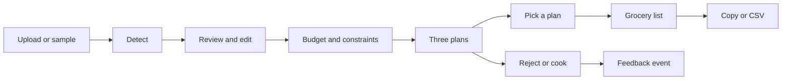
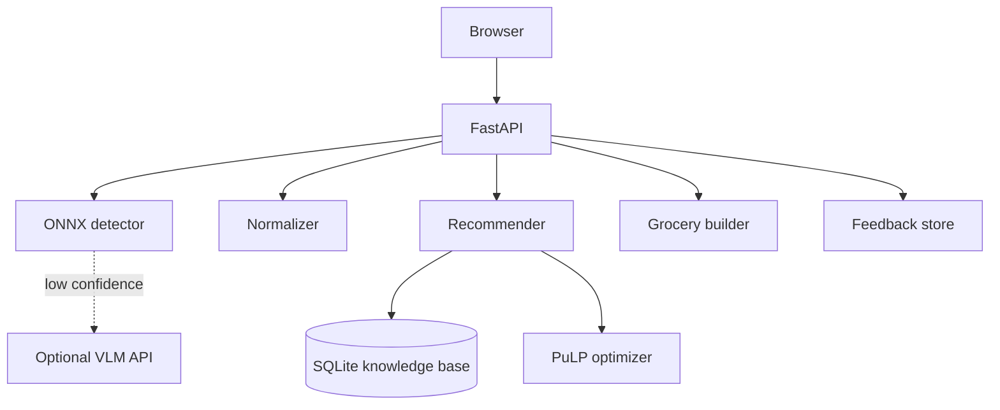
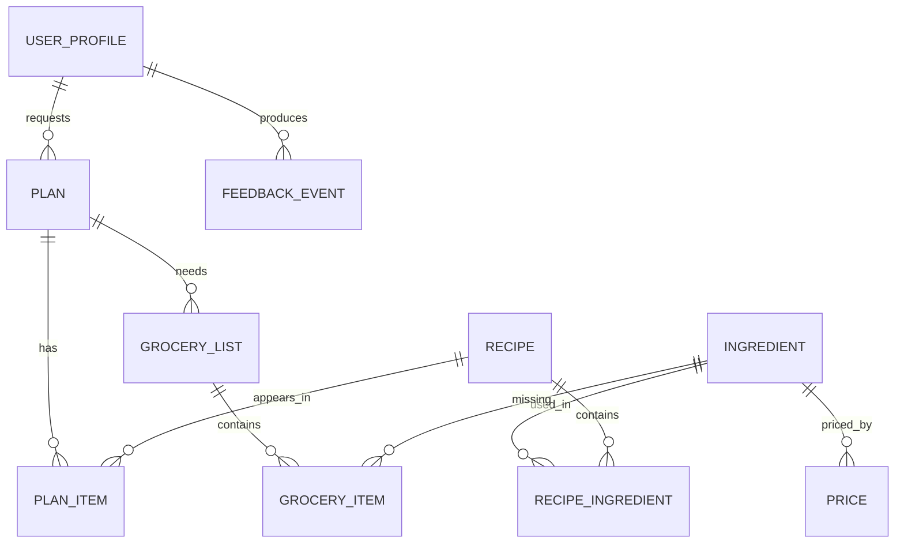

# Pantrified

Fridge photo to a budgeted meal plan and a shopping list for what is missing.

| Field | Value |
|---|---|
| Version | 0.2 |
| Date | 2026-10-29 |
| Status | Draft |
| Owner | Solo developer, machine learning background, based in Indonesia |
| Type | Web app with an AI vision feature, plus the API behind it |
| Delivery method | Kanban, work in progress limit 2, weekly demo |
| Target launch | 2027-01-15 public demo and portfolio write-up |

## Contents

Product: TL;DR, context and problem, users, goals, scope, features, flows.
Design and build: design system, architecture, data model, API, infrastructure, security, testing, workflow, deployment.
Planning: analytics, roadmap, costs, risks, appendices.

## TL;DR

Pantrified turns a phone photo of a fridge into three affordable Indonesian meal plans that use what is already there, then lists only the missing ingredients with prices. It is built for students and young professionals in Indonesia who lose time and money deciding what to eat.

| Path | Stack | Cost to launch | Monthly at launch |
|---|---|---|---|
| Free | Google Cloud Run in Jakarta, 1 vCPU and 1 GB, SQLite, ONNX Runtime, no LLM by default | Rp 0 (about $0), billing account required | $0 inside the free tier |
| Ideal | Render 1 CPU and 2 GB, Postgres, LLM explanations on | about $12 for a domain | about $25 plus usage |

MVP scope:
- Upload or pick a fridge photo, review and edit the detected ingredients.
- Enter a daily budget in IDR, plus optional calories, diet, and cook time.
- Get three plans with cost, calories, cook time, and an explanation.
- Get a grocery list of missing items only, with a total and a price date.
- Copy the list as text or download it as CSV.

Design direction: warm kitchen ledger, cream paper, deep green, turmeric accent, rounded photo cards with pill badges, large numerals for money, restrained motion.

Top risks: detector accuracy in messy real fridges (R-1), thin Indonesian recipe and price data (R-3), and scope creep across optional models (R-4).

| Assumption | Why | How to change it |
|---|---|---|
| One developer, part time, CPU only | Stated in the brief | Add a builder or a GPU and shorten the vision phase |
| Indonesian first, English toggle later | Food data, prices, and audience are Indonesian | Change the default locale in the app config |
| Jakarta price table first | Most public price data covers Jakarta | Swap the region and re-seed the price table |
| No payments in the MVP | Keeps scope, tax, and compliance small | Add a paid tier after the user study |
| Photos discarded after the response | Fridge photos can expose private life | Add opt-in retention with consent |

## Context and problem

People decide what to eat several times a day with no memory of what they already own, what it cost, or when it expires. The result is wasted time, wasted food, and expensive delivery orders.

| Problem | Who feels it | Today | Cost |
|---|---|---|---|
| Decision fatigue at mealtime | Students and young professionals | Scroll delivery apps, then pick by mood | 10 to 20 minutes a day, higher spend |
| No view of what is already at home | Anyone who shops weekly | Buy duplicates, forget the back of the fridge | Spoiled produce, repeated spending |
| Plans ignore the wallet | Budget-conscious households | Recipe apps suggest dishes with missing, costly items | Budget overshoot at the till |
| Plans ignore local food | Indonesian cooks | Most apps are Western recipe libraries | Low trust, poor fit |

Alternatives today, checked 2026-10-29:

| Product | Price | Strength | Gap |
|---|---|---|---|
| SuperCook | Free, no paid tier | 11 million recipes, tick-list ingredient search | No budget, no nutrition, no photo, no planner |
| Samsung Food | Free, Food+ $6.99 a month | Large library, photo ingredient recognition in the paid tier | No Indonesian prices or budget logic |
| Mealime | Free limited, Pro about $5.99 a month | Clean weekly planning and one consolidated list | Plan first, ignores the pantry |
| KitchenPal | Free to 100 items, Premium $3.99 a month | Expiry tracking and reminders | Western pricing, no budget optimizer |
| Cooklist | Free, Pro about $5.99 a month | Pantry filled from US loyalty cards | US retail integrations only |
| MyFridgeFood | Free | Simple ingredient checklist | No planner, no prices, no vision |

The space is crowded with recipe search. The gap is the combination: photo input, an Indonesian price table, a hard budget constraint, and a list of only the missing items. Pantrified competes on local fit and on finishing the job at the till, not on recipe count.

## Users

Rani, 24, final-year student in Bandung, shares a kitchen with three people, cooks on a two-burner stove, shops at a local market twice a week, and has about Rp 30.000 a day for food. She wants a plan that uses the tempe and kangkung already in the fridge and tells her the smallest top-up shop.

Dimas, 29, analyst in Jakarta, cooks three times a week after work, tracks protein loosely, and orders delivery when tired. He wants a fast decision with a calorie estimate and a total cost he can trust.

Jobs to be done:
- When I open the fridge and feel stuck, I want three concrete meals so I stop scrolling.
- When I shop, I want to buy only what the plan is missing.
- When money is tight, I want the plan to respect today's budget.
- When food is about to spoil, I want the plan to use it first.
- When I cook, I want a short method and a realistic time.

First run: land on the page, tap a sample photo, confirm six ingredients, type a budget, and see three plans in under two minutes.

## Goals, metrics, and non-goals

| ID | Goal | Metric | Target | Method | When |
|---|---|---|---|---|---|
| G-1 | Detect ingredients well enough to edit, not to trust blindly | Per-photo recall after dedupe | 0.80 or higher | Frozen real-photo test set | End of week 4 |
| G-2 | Keep plans inside the budget | Requests where missing cost is at or under budget | 98% or higher | Offline scenarios plus beta logs | End of week 5 |
| G-3 | Use what people already own | Fridge utilization versus overlap-only baseline | +25% relative | 500 synthetic scenarios | End of week 5 |
| G-4 | Cut decision time | Median time to pick a meal versus the user's usual | 40% lower | User study, n of 10 or more | Week 8 |
| G-5 | Ship a credible portfolio artefact | Public demo live, README claims backed by numbers | All claims sourced | Review checklist | Week 10 |

Guardrails: API error rate under 1%, photo to list p95 at 3 seconds or less on 1 vCPU, and no plan that claims a dish is allergen free.

Non-goals: medical or disease nutrition advice, automatic checkout with a grocery vendor, training a large model from scratch, a native mobile app, and multi-household accounts.

## Scope and release plan

| Priority | Item | Feature |
|---|---|---|
| Must | Photo upload, detection, review and edit | F-001, F-002, F-003, F-004 |
| Must | Budget and constraint form | F-005 |
| Must | Three plans with explanation | F-006, F-007 |
| Must | Grocery list, export, consent, deletion | F-008, F-009, F-013, F-014 |
| Should | Feedback capture and preference ranking | F-010, F-011 |
| Should | Assumed pantry staples, sample photos | F-012, F-015 |
| Could | Freshness ranking, quantity estimates, LLM explanations | M3, M4, LLM layer |
| Won't for now | Live vendor checkout, native app, family accounts | Out of MVP |

MVP in one sentence: a public web demo where a visitor uploads a fridge photo, confirms the ingredients, enters a budget, and leaves with three plans and a priced shopping list.

| Phase | Exit criteria |
|---|---|
| Foundations, week 1 | Repo, CI, one deployed hello world, decision log started |
| Private beta, weeks 6 to 7 | 10 to 15 testers, top bugs closed, error rate under 2% |
| Public demo, week 10 | Legal pages live, consent working, rollback tested, audit done |

Constraints: one part-time developer, CPU-only laptop, near-zero budget, 8 to 10 weeks, and dependence on public price and recipe sources.

## Features and requirements

| ID | Feature | Priority | Effort | Acceptance criteria |
|---|---|---|---|---|
| F-001 | Fridge photo upload | Must | M | Given a JPEG, PNG, or WebP under 10 MB, when uploaded, then it is resized to 1280 px and EXIF is stripped before inference. |
| F-002 | Ingredient detection | Must | L | Given a photo, when inference runs, then the API returns ingredient IDs with confidence and boxes in 3 seconds or less on 1 vCPU. |
| F-003 | Review and edit list | Must | M | Given detections, when the review screen opens, then each item can be removed, renamed, or added by search in under 30 seconds. |
| F-004 | Canonical mapping | Must | M | Given detector labels or free text, when normalized, then 95% or more of the seed vocabulary maps to one canonical ID. |
| F-005 | Budget and constraints | Must | S | Given a session, when a budget in IDR is entered, then no returned plan exceeds it. |
| F-006 | Plan recommendation | Must | L | Given fridge items and constraints, when requested, then three plans return in under 1 second with cost, calories, and time. |
| F-007 | Explanation text | Must | S | Given a plan, when shown, then it names used ingredients, missing cost, calories, and cook time from templates without an LLM. |
| F-008 | Grocery list | Must | M | Given a chosen plan, when generated, then only missing items appear, merged and rounded to pack sizes, with a total and price date. |
| F-009 | Export and share | Must | S | Given a list, when exported, then the WhatsApp text and CSV totals match the screen total. |
| F-010 | Feedback capture | Should | S | Given a plan, when the user selects, cooks, or rejects it, then one event is stored with a timestamp. |
| F-011 | Preference ranking | Should | M | Given 20 or more events, when ranking, then acceptance on simulated users beats the non-personalized baseline. |
| F-012 | Assumed staples | Should | S | Given a new user, when they plan, then salt, oil, sugar, and soy sauce are assumed available and editable. |
| F-013 | Consent and retention | Must | S | Given a first visit, when the app loads, then analytics stay off until consent and photo retention is off by default. |
| F-014 | Deletion and export | Must | S | Given a deletion request, when confirmed, then data is removed within 7 days and an export is offered first. |
| F-015 | Sample photos | Should | S | Given a visitor without a photo, when a sample is chosen, then the full flow runs on a bundled image. |

| Area | Target |
|---|---|
| Photo to list, 1 vCPU | 3 seconds or less, p95, warm instance |
| Plan generation | 1 second or less, p95 |
| Availability | 99% monthly for the demo, cold starts allowed |
| Browsers | Chrome, Safari, Firefox, Edge, last two versions, mobile Safari 16 or newer |
| Accessibility | WCAG 2.2 AA |
| Localization | Indonesian first, English strings present in the catalogue |
| Upload limit | 10 MB, JPEG, PNG, or WebP |
| Retention | Photos discarded after the response by default |

## User flows and information architecture

| ID | Screen | Purpose |
|---|---|---|
| S-01 | Start | Explain the product, offer upload or a sample photo |
| S-02 | Review ingredients | Confirm, remove, rename, or add items |
| S-03 | Constraints | Budget, calories, diet, cook time, servings |
| S-04 | Plans | Three plans with cost, calories, time, and reason |
| S-05 | Plan detail | Ingredients, method, and what is missing |
| S-06 | Grocery list | Missing items, pack sizes, total, export |
| S-07 | Settings and data | Consent, staples, export, deletion |



| Screen | Loading | Empty | Error | Offline | Success |
|---|---|---|---|---|---|
| S-01 | Spinner on upload | Sample prompt | File too large or wrong type | Banner, sample disabled | Preview shown |
| S-02 | Skeleton list | No items found, add manually | Detection failed, retry | Cached list | Editable list |
| S-03 | Not needed | Defaults filled | Budget below minimum | Last values kept | Constraints accepted |
| S-04 | Three skeletons | No plan fits, relax one constraint | Engine error, retry | Cached plans | Three cards |
| S-06 | List skeleton | Nothing missing | Price table unavailable, show date | Cached list | Total shown |

```text
+----------------------------------+
| Review ingredients        [Edit] |
+----------------------------------+
| [x] Tempe            150 g    x  |
| [x] Kangkung         1 ikat   x  |
| [x] Telur            3 butir  x  |
| [?] Bawang merah     5 siung  x  |
|                                  |
| + Add an item                    |
|                                  |
| 4 items, 1 needs a check         |
| [ Looks right, continue ]        |
+----------------------------------+
```

## Design system

Design read: a warm kitchen ledger wearing a soft card layout. A phone in one hand in a kitchen, low light, low patience. Density is low, type is large, and money is the loudest number on the screen. Color stays cream, deep green, and turmeric. The personality comes from the layout: big rounded cards, photo-first tiles, pill badges, one budget ring, and a single round action button.

Formatting reference, supplied 2026-10-29: a pastel nutrition app shown as three phone screens. Taken from it: the 24 px card radius, the two-up photo grid, titles set over a photo scrim, pill meta rows, ring metrics, tinted circular icon buttons, a floating round action, a bottom tab bar, and a segmented tab row. Left out: the pastel palette, the pink accent, the decorative blobs, and the heavy drop shadows. The palette below is unchanged from the warm kitchen direction, so the formatting can be copied without importing the reference's colors.

| Formatting rule | Value | Applies to | Why |
|---|---|---|---|
| Outer card radius | 24 px | Cards, sheets, tiles | Gives the card weight the reference relies on |
| Inner radius | 16 px | Images, inputs, chips inside a card | Nested shapes stay concentric |
| Pill radius | 999 px | Badges, filters, tabs | A fact reads as a token, not a paragraph |
| Card padding | 16 px, 20 px from 768 px | All cards | Two tiles fit a 375 px screen |
| Grid gap | 12 px mobile, 16 px desktop | Tile grids | Keeps the two-up grid from feeling cramped |
| Card elevation | 1 px `--border-subtle` plus 0 2px 8px rgba(28,27,24,0.06) | Cards on `--bg` | Border carries the edge, shadow only lifts |
| Photo tile | 4:3, `object-fit: cover`, title over a bottom scrim | Plan and recipe cards | Food is the fastest way to choose a meal |
| Scrim | linear-gradient(transparent, rgba(28,27,24,0.78)) | Text over a photo | White on the scrim measures 9.62:1 |
| Meta row | Pills at 28 px tall, 12 px label, icon at 14 px | Calories, time, cost, servings | Four facts read in one pass |
| Ring | 96 px, 8 px stroke, rounded cap, one value | Budget used, macro split | One number per ring, never two |
| Round icon button | 40 px circle, tinted fill, 20 px icon | Back, save, search, filter | Matches the reference's header controls |
| Primary action | 56 px circle, fixed bottom center above the tab bar | New plan, add item | Thumb reach on a phone |
| Tab bar | 5 items maximum, 56 px tall, label under icon | Mobile navigation | Replaces the drawer below 768 px |
| Segmented tabs | 2 px underline, 44 px tall | Description, ingredients, method | Keeps a long detail screen short |
| Sheet | Slides up, 24 px top radius, drag handle | Plan detail, filters | Keeps the list underneath in view |

| Token | Value | Use | Contrast |
|---|---|---|---|
| `--bg` | #FAF7F0 | Page surface | Text 16.10:1 |
| `--surface` | #FFFFFF | Cards and inputs | Text 17.22:1 |
| `--ink` | #1C1B18 | Body text | 16.10:1 on bg |
| `--muted` | #5B584F | Secondary text | 6.65:1 on bg |
| `--primary` | #1F4D3A | Buttons and links | 9.00:1 on bg |
| `--on-primary` | #FFFFFF | Text on primary | 9.63:1 |
| `--accent` | #B45309 | Money and warnings | 4.69:1 on bg |
| `--danger` | #B3261E | Errors | 6.11:1 on bg |
| `--border-strong` | #8C8270 | Input borders | 3.54:1 on bg |
| `--border-subtle` | #E3DCCB | Dividers and card edges | Decorative |
| `--surface-tint` | #F3EDE0 | Pill fills, skeletons | Ink 14.76:1 |
| `--tint-green` | #E3EFE7 | Success chips, under budget | Green text 8.15:1 |
| `--tint-amber` | #FBEBD9 | Money chips | Brown text 5.81:1 |
| `--scrim` | rgba(28,27,24,0.78) | Photo overlay | White 9.62:1 |

```css
:root {
  --bg: #FAF7F0;
  --surface: #FFFFFF;
  --ink: #1C1B18;
  --muted: #5B584F;
  --primary: #1F4D3A;
  --on-primary: #FFFFFF;
  --accent: #B45309;
  --danger: #B3261E;
  --border-strong: #8C8270;
  --border-subtle: #E3DCCB;
  --surface-tint: #F3EDE0;
  --tint-green: #E3EFE7;
  --tint-amber: #FBEBD9;
  --scrim: rgba(28, 27, 24, 0.78);
  --radius-card: 24px;
  --radius-inner: 16px;
  --radius-pill: 999px;
  --space: 4px;
  --shadow-card: 0 2px 8px rgba(28, 27, 24, 0.06);
  --font-ui: "Plus Jakarta Sans", system-ui, sans-serif;
  --font-display: "Fraunces", Georgia, serif;
}
```

Type: Plus Jakarta Sans for interface text (OFL, by Tokotype in Jakarta), Fraunces for display headings (OFL). Scale 12, 14, 16, 20, 28, 40 px, line height 1.5 for body and 1.2 for headings. Money uses tabular figures at 20 to 40 px. Card titles sit at 20 px semibold, and a photo title is white at 20 px semibold.

Icons: Phosphor Icons (MIT), 1.5 px stroke, 16 px in pills, 20 px in lists and round buttons, 24 px in the tab bar. No icon-only button without an accessible name.

Components and states:

| Component | States | Notes |
|---|---|---|
| App bar | Default, scrolled, with back | Title 28 px, one trailing round button |
| Upload dropzone | Default, drag over, uploading, error | Dashed 2 px border, 24 px radius |
| Photo preview | Loaded, cropping, failed | 4:3, keeps the subject centered |
| Ingredient row | Default, checked, needs check, removed | Checkbox, name, quantity, remove |
| Add item search | Empty, typing, no result | Results in a sheet, 44 px rows |
| Budget input | Default, focus, invalid, valid | IDR prefix, tabular figures |
| Plan tile | Default, hover, selected, unavailable | Photo, scrim title, three pills |
| Cost badge | Under, at, over budget | Amber tint, green tint, danger text |
| Budget ring | Empty, partial, full, over | One value, no second ring |
| Method list | Default, step done | Numbered, 16 px text |
| Grocery row | Default, checked, unavailable price | Name, packs, price, price date |
| Total bar | Default, updating, stale price | Sticky bottom, 20 px tabular |
| Consent banner | First visit, accepted, rejected | Sheet on mobile, bar on desktop |
| Toast | Success, error, undo | 4 seconds, one action maximum |
| Empty state | No items, no plan, no list | One sentence and one action |
| Error banner | Retryable, blocking | Plain cause and a next step |

Layout: one column for forms at 375 px, two-up tiles from 375 px, three-up from 768 px, four-up from 1280 px. Content width 1120 px. The tab bar shows below 768 px, the sidebar from 768 px. Safe area padding at the bottom for the round action. Dark mode is out of scope for the MVP; token names allow a dark set later.

```text
+----------------------------------+
| Pantrified            [search]   |
+----------------------------------+
|  Budget left                     |
|    ( 72% )       Rp 8.400        |
|     ring         of Rp 30.000    |
+----------------------------------+
| [ photo ]        [ photo ]       |
| Nasi goreng      Tempe orek      |
| 640 kcal         410 kcal        |
| 20 min           Rp 4.100        |
+----------------------------------+
| [ photo ]        [ photo ]       |
| ...              ...             |
+----------------------------------+
|           ( + )  new plan        |
+----------------------------------+
```

Streamlit MVP: radius, spacing, tile grid, pill badges, ring, and type scale are themeable with custom CSS and are in scope for M5. The floating round action, bottom tab bar, and slide-up sheets are app patterns that Streamlit cannot do cleanly, so the MVP uses a top action button and a sidebar, and those three rules move to the React PWA milestone. The component inventory above describes the target; the MVP ships the cards, pills, ring, lists, and bars, and defers the app-shell parts.

| Element | Trigger | Motion | Duration | Easing | Reduced motion |
|---|---|---|---|---|---|
| Plan tile enter | Results arrive | Fade and 8 px rise, 40 ms stagger | 180 ms | ease-out | Opacity only |
| Tile press | Tap | Scale to 0.98 | 90 ms | ease-out | None |
| Ingredient remove | User removes item | Collapse height and fade | 140 ms | ease-in | Instant |
| Total update | List changes | Number crossfade | 120 ms | linear | Instant |
| Ring fill | Budget computed | Stroke dash offset | 400 ms | ease-out | Final value only |
| Sheet open | Detail or filter | Slide up with scrim fade | 220 ms | ease-out | Instant |
| Tab change | Navigation | Underline slides | 160 ms | ease-out | Instant |
| Screen change | Navigation | View transition, no slide | 200 ms | ease-out | Instant |
| Error banner | Failure | Fade in | 120 ms | ease-out | Instant |
| Loading skeleton | Request starts | Slow shimmer on `--surface-tint` | 1200 ms loop | linear | Static block |

Accessibility: WCAG 2.2 AA, visible focus ring at 2 px in `--primary` with a 2 px offset, 44 px minimum targets, 24 px minimum for inline controls, labels tied to inputs, photo titles repeated in the card's accessible name, and no meaning carried by color alone. The scrim is part of the component, not an optional style, because white text over an unscrimmed photo fails.

Swap protocol:
- Keep token names, change values only.
- Formatting swaps change radius, spacing, elevation, and tile geometry. They never change copy, flows, or data.
- Replace the type pair in one place and re-check the scale.
- Recompute contrast for every text and border pair before merging.
- Restyle components through tokens, never through one-off colors.
- Re-check the four viewport widths after a swap.

## Architecture and tech stack

| Decision | Free pick | Ideal pick and price | Switch trigger | Reason |
|---|---|---|---|---|
| Language and tooling | Python 3.11, uv, ruff, pytest | Same | Never | One language for ML and API, fast setup |
| Detector | YOLO nano fine-tuned, ONNX Runtime on CPU | Same, larger input size | Recall below 0.75 after tuning | Small model fits 1 vCPU and a 512 MB budget |
| Detector license | Ultralytics YOLO under AGPL-3.0, whole repo open | Enterprise license, quote on request | The project becomes closed source | AGPL fits a public portfolio, not a closed product |
| VLM fallback | Optional API call behind `VLM_ENABLED` | Gemini Flash-Lite class model, usage based | Detector confidence is low on many photos | Improves recall without a GPU |
| Recipe retrieval | Precomputed embeddings, cosine in NumPy | FAISS when recipes pass 5.000 | Query time above 200 ms | Avoids loading torch at runtime |
| Optimizer | PuLP, CBC solver | OR-Tools CP-SAT | Plan time above 1 second | PuLP is smaller to deploy |
| Backend | FastAPI and Pydantic | Same | Never | Typed contracts and cheap hosting |
| Database | SQLite file | Postgres, $0 on Neon free or Supabase free | Writes from more than one instance | SQLite fits a single instance |
| Frontend | Streamlit with a custom theme | React and Next.js PWA | Design fidelity blocks the demo | Streamlit ships the flow in days |
| Hosting | Cloud Run, Jakarta, 1 vCPU and 1 GB, scale to zero | Render 1 CPU and 2 GB, $25 a month | Cold starts hurt visitors or memory passes 900 MB | Free tier with a local region |
| Experiment tracking | Weights and Biases free | Same | Team use or private runs | Free plan covers one user |
| CI | GitHub Actions | Same | Never | Free for public repos |



```text
pantrified/
  pyproject.toml
  .env.example
  data/            raw, interim, processed, git ignored
  docs/            decisions, data_sources, evaluation, privacy
  notebooks/       exploration only
  src/pantrified/
    vision/        detector, vlm_fallback, postprocess, export_onnx
    ontology/      ingredient ids, aliases, normalizer
    kb/            recipes, nutrition, prices
    recommend/     retrieve, filter, score, optimize, explain
    personalization/
    grocery/
    api/
    app/
  scripts/         train, evaluate, autolabel, build_kb
  configs/
  tests/
  docker/
```

## Data model

| Table | Columns |
|---|---|
| `ingredient` | id, name_id, name_en, aliases, category, default_unit, shelf_life_days, halal, allergens, assumed_available, kcal_100g, protein_100g, nutrition_source |
| `recipe` | id, title, servings, cook_time_min, equipment, steps, tags, diet, kcal_serving, protein_serving, est_cost_idr, source_name, source_url, license |
| `recipe_ingredient` | recipe_id, ingredient_id, qty, unit, optional |
| `price` | ingredient_id, region, unit, idr_per_unit, price_date, source |
| `user_profile` | id, session_id, budget_idr, kcal_target, protein_target, diet, allergies, dislikes, spice, servings, equipment, staples, consent_analytics, created_at |
| `plan` | id, profile_id, budget_idr, total_missing_idr, kcal_total, created_at, chosen |
| `plan_item` | plan_id, recipe_id, position, score, reason |
| `feedback_event` | id, profile_id, plan_id, recipe_id, event, created_at |
| `grocery_list` | id, plan_id, total_idr, price_date, created_at |
| `grocery_item` | list_id, ingredient_id, qty, unit, pack_size, packs, est_idr |

Authorization: rows belong to a session identifier held in an HTTP-only cookie; no endpoint accepts another session's identifier; the knowledge base is read only for the app and writable only by a local build script; deletion removes profile, plans, lists, and events in one transaction.

Retention: photos are held in memory and discarded after the response; plans and lists keep 12 months; feedback events keep 24 months; deletion completes within 7 days; analytics events carry no free text.



## Backend and API

| ID | Method and path | Auth | Limit | Purpose |
|---|---|---|---|---|
| E-01 | POST /v1/sessions | None | 10 a minute per IP | Create an anonymous session and set an HTTP-only cookie |
| E-02 | POST /v1/detect | Session | 20 an hour | Upload a photo and return detections |
| E-03 | POST /v1/ingredients/resolve | Session | 60 a minute | Map free text to canonical ingredient IDs |
| E-04 | POST /v1/plans | Session | 30 an hour | Return three plans for a fridge and constraints |
| E-05 | GET /v1/recipes/{id} | Session | 120 a minute | Recipe detail for the plan screen |
| E-06 | POST /v1/feedback | Session | 120 a minute | Store one feedback event |
| E-07 | POST /v1/grocery-lists | Session | 30 an hour | Build a list for a chosen plan |
| E-08 | GET /v1/me/export | Session | 3 a day | Export profile, plans, and events as JSON |
| E-09 | DELETE /v1/me | Session plus confirm token | 1 a day | Delete the session and all owned rows |
| E-10 | GET /v1/health | None | 60 a minute | Report build version and model checksum |

Example request:

```json
POST /v1/plans
{
  "ingredients": [{"id": "ing_tempe", "qty": 150, "unit": "g"}],
  "budget_idr": 30000,
  "kcal_target": 650,
  "meals": 1,
  "max_cook_min": 25,
  "diet": {"halal": true, "vegetarian": false},
  "allergies": []
}
```

| Code | Name | When | Body |
|---|---|---|---|
| 400 | invalid_input | Schema or range failure | Field name and rule |
| 413 | image_too_large | Over 10 MB | Limit and received size |
| 422 | unprocessable_image | Not a decodable image | Reason code |
| 429 | rate_limited | Over the limit | Retry after seconds |
| 500 | internal_error | Unhandled fault | Request identifier only |
| 503 | detector_unavailable | Model or VLM down | Retry after seconds |

Background jobs: a nightly price refresh script run by hand, a weekly embedding rebuild after recipe edits, and a daily check that the price table date is under 30 days old. No job processes a user photo.

## Infrastructure and environments

| Environment | Purpose | Data | URL |
|---|---|---|---|
| Local | Development and evaluation | Seed knowledge base, no real photos | localhost |
| Preview | One per pull request | Seed data, synthetic sessions | Preview URL |
| Production | Public demo | Live sessions, SQLite or Postgres | Public domain |

Backups: the SQLite file is copied to object storage daily with a 24 hour recovery point and a 2 hour recovery time; the knowledge base is rebuilt from the repo in under 10 minutes; the Postgres path uses daily snapshots with a 7 day window on the paid tier.

Observability: structured JSON logs with request ID, route, status, and duration; latency histograms for detection and planning; counters for detections, edits, plans, and exports. Logs never contain photo bytes or free text.

| Alert | Threshold | Window | Action |
|---|---|---|---|
| Error rate | Above 2% | 10 minutes | Page the owner, check the last deploy |
| Detection latency | p95 above 5 seconds | 10 minutes | Scale to 2 instances or roll back |
| Memory | Above 90% | 5 minutes | Raise memory or drop the image size |
| VLM spend | Above $5 | Month | Disable the flag until reviewed |
| Price table age | Above 30 days | Daily | Refresh and show a stale badge |

## Security, privacy, and compliance

Standards in force: OWASP Top 10, 2025 edition; OWASP LLM Top 10, 2025 edition, only when the LLM layer is enabled; OWASP ASVS, version to confirm at build time; WCAG 2.2 AA for the interface; Indonesia UU PDP, Law 27 of 2022, with Government Regulation 33 of 2026.

| OWASP 2025 | Applies | Control |
|---|---|---|
| A01 Broken access control | Yes | Session ownership on every row, authorization tests per endpoint |
| A02 Security misconfiguration | Yes | Debug off, security headers, least privilege on the host |
| A03 Software supply chain failures | Yes | Lockfile, pinned images, pip-audit in CI, model checksum |
| A04 Cryptographic failures | Yes | TLS only, signed session cookie, no custom crypto |
| A05 Injection | Yes | Pydantic validation, parameterized SQL, no shell from input |
| A06 Insecure design | Yes | Budget caps, rate limits, this threat model |
| A07 Authentication failures | Yes | Anonymous signed sessions, rotation on delete |
| A08 Software or data integrity failures | Yes | Signed releases, checksum on the ONNX file |
| A09 Security logging and alerting failures | Yes | Structured logs and the alerts above |
| A10 Mishandling of exceptional conditions | Yes | Typed error model, no stack traces to users |

LLM rows when the flag is on: LLM01 prompt injection through text visible in a photo, LLM05 improper output handling, and LLM10 unbounded consumption.

| ID | Threat | STRIDE | Mitigation |
|---|---|---|---|
| T-1 | A fridge photo reveals documents, medicine, or people | Information disclosure | Discard by default, crop hint in the UI, no storage without opt-in |
| T-2 | Text in a photo tells the VLM to change prices or output | Tampering | Treat all model output as data, schema validation, no tools for the VLM |
| T-3 | Repeated calls burn the VLM budget | Denial of service | Rate limits, per-session cap, monthly spend alert |
| T-4 | One session reads another user's plan | Elevation of privilege | Cookie-only session lookup, ownership check in the query |
| T-5 | A bad price row hides the real cost | Tampering | Price date shown, source per row, build-time validation |
| T-6 | A compromised dependency reaches production | Tampering | Lockfile, pip-audit, pinned base image, gitleaks |
| T-7 | A plan is called allergen free when it is not | Spoofing | Never claim allergen free, show unknown packaged items as a warning |
| T-8 | A dataset photo is used without consent | Information disclosure | Written consent, faces blurred, deletion on request |

| Data | Where | Purpose | Retention | Leaves the system |
|---|---|---|---|---|
| Photo bytes | Memory only | Detection | Seconds | To the VLM provider only when the flag is on |
| Detected items | Request | Planning | Not stored | No |
| Profile constraints | Database | Planning | 12 months | No |
| Feedback events | Database | Ranking | 24 months | No |
| Analytics events | Analytics store | Product metrics | 14 months | No free text, IP truncated |
| Server logs | Host | Debugging | 30 days | Host provider only |

Legal documents plan, headings only, lawyer review before launch:
- Privacy policy: who we are, data we collect, why, legal basis, retention, sharing, cookies, your rights, deletion, contact, changes.
- Terms of service: acceptance, service description, acceptable use, estimates and no medical advice, allergen warning, intellectual property, liability, termination, governing law.
- Cookie policy: essential cookies, analytics cookies, consent, changing your choice.

Consent design: a first-visit banner with accept all, reject non-essential, and customize; analytics off until a choice is stored with timestamp and version; photo retention off by default and opt-in only; withdrawal on S-07 clears analytics identifiers.

| Region | Rule | Status |
|---|---|---|
| Indonesia | UU PDP 27 of 2022, PP 33 of 2026, explicit consent, breach notice within 3 by 24 hours, PSE registration if the criteria apply | Applies, confirm PSE scope |
| EU and EEA | GDPR baseline | Only if the demo is promoted there |
| Others | Not targeted | Out of scope |

Store policy checklist: no app store submission in the MVP. The web app still needs a privacy policy page, a terms page, a cookie banner, and a working deletion path before launch.

Incident response: one page runbook naming the owner, the 3 by 24 hour regulator notice path, a user notice template, and a postmortem within 7 days. Secrets live in the host environment, never in the repo, and rotate on any suspicion.

Pre-launch code security audit: run Cloudflare's open-source `security-audit` skill in a sandbox before the beta and again on the release candidate. Requirements are Node.js, an agent with sub-agents, and an isolated copy of the repo. Triage findings as confirmed, needs validation, or rejected, and close every confirmed high finding before launch. It is budgeted as agent usage, not as a cash line.

## Testing and quality

| Layer | Tool | Target |
|---|---|---|
| Unit | pytest | 80% or more on ontology, grocery, and optimizer |
| Contract | pytest and httpx | Every endpoint has a schema test |
| Vision evaluation | Custom harness on the frozen test set | Recall 0.80, precision 0.75, mAP@0.5 0.60 |
| Recommendation evaluation | Script over 500 scenarios | 98% budget satisfaction, utilization above baseline |
| End to end | Playwright | Six flows at 375, 768, 1280, and 1920 px |
| Accessibility | axe-core inside Playwright | Zero critical issues |
| Performance | k6 | p95 detection at 3 seconds or less |
| Security | Semgrep, pip-audit, gitleaks | Zero high findings |
| Code security audit | Cloudflare security-audit | Before beta and on the release candidate |

End-to-end flows by feature: F-001 upload to review, F-003 edit and add an item, F-005 budget entry and validation, F-006 three plans shown, F-008 list with total, F-013 consent and analytics off, F-014 export then delete.

Beta plan: 10 to 15 testers from campus and an office, five days of use, one short form, three follow-up questions, and a weekly review of error logs and edit rates. Every bug gets a severity from 1 to 4, with a 24 hour response target for severity 1 and 2.

Definition of done for each milestone: tests green, CI green, accessibility check passed, audit findings triaged, PRD updated, and the demo URL works on a phone.

Playwright was not checked in the planning environment. Install it as a project dependency later and run it in CI; the local visual check uses the four viewport widths above.

## Development workflow

Method: Kanban with a work in progress limit of 2 and a weekly demo. Trunk-based development with short branches, feature flags for unfinished work, and a preview deploy per pull request.

```bash
uv sync
uv run ruff check . && uv run ruff format --check .
uv run pytest
uv run uvicorn pantrified.api.main:app --reload
uv run streamlit run src/pantrified/app/streamlit_app.py
```

Build kit, at most four tools, one always-on:

| Tool | Role | When |
|---|---|---|
| ponytail | Reuse-first coding discipline | Always on |
| playwright-cli | Visual and flow checks | On demand |
| security-audit | Deep audit at the two gates | Before beta and on the release candidate |
| caveman | Shorter agent replies, skill only | Optional, off by default |

| Variable | Purpose | Required |
|---|---|---|
| `DATABASE_URL` | SQLite path or Postgres URL | Yes |
| `DETECTOR_PATH` | ONNX model file | Yes |
| `DETECTOR_BACKEND` | `onnx` or `stub` | Yes |
| `VLM_ENABLED` | Turns the optional vision model on | Yes |
| `VLM_API_KEY` | Provider key, only when enabled | No |
| `VLM_MODEL` | Model name, never hard-coded | No |
| `PRICE_TABLE_PATH` | Versioned price file | Yes |
| `SESSION_SECRET` | Cookie signing key | Yes |
| `SENTRY_DSN` | Error reporting, optional | No |
| `ENV` | `local`, `preview`, or `production` | Yes |

Agent instructions for `AGENTS.md`, eight bullets or fewer:
- `PRD.md` is the specification; work one milestone at a time.
- Run `ruff` and `pytest` before every commit.
- Never commit photos, keys, model weights, or the SQLite file.
- Keep the detector behind its interface so it can be swapped.
- Never invent prices, nutrition values, or ingredients; read them from the knowledge base.
- The VLM never returns prices or nutrition; it only rewrites text.
- Add a test for every module that computes money, nutrition, or authorization.
- Ask before adding a dependency or a paid service.

## Deployment and shipping plan

Pipeline: GitHub Actions runs lint, type check, unit tests, contract tests, pip-audit, gitleaks, and a container build on every push; pull requests get a preview deploy; `main` deploys to Cloud Run with a revision tag.

Rollback: Cloud Run keeps prior revisions, so traffic moves back to the previous revision in under 5 minutes with one command. Database changes are additive and stay backward compatible for one release. Model files are versioned by checksum, and the previous file stays in the bucket.

Launch checklist:
- [ ] Privacy policy, terms, and cookie policy pages live and linked.
- [ ] Consent banner working, analytics off by default.
- [ ] Deletion and export tested end to end.
- [ ] Security audit complete, confirmed high findings closed.
- [ ] Monitoring, alerts, and the cost cap active.
- [ ] Rollback tested on production.
- [ ] Sample photos load for visitors without a fridge photo.
- [ ] README claims match the evaluation tables.

First 72 hours: watch error rate, p95 latency, VLM spend, and the edit rate; answer reports within 24 hours; freeze feature work and fix only regressions; post a short status note if a known issue persists.

Store steps: none for the MVP. The public demo runs on the web, and the PSE registration question is tracked as OQ-3.

## Analytics, growth, and monetization

Measurement: a small self-hosted event table, or no analytics at all in the first beta. Events are `session_start`, `photo_uploaded`, `detection_shown`, `ingredient_edited`, `plan_shown`, `plan_selected`, `grocery_exported`, and `consent_changed`. Each event carries a session ID, a timestamp, and a coarse device class, never free text or photo content.

Funnels: upload to plan, plan to export, and edit count per session. The edit rate is the honesty metric for detection quality.

Launch plan: a 2 minute video, a GitHub repo with the evaluation tables, a short write-up, posts in two Indonesian campus communities, and one LinkedIn post. Ask ten people for a five minute session in the first week.

Monetization: none in the MVP. Later options are affiliate links to grocery partners, a freemium tier for weekly planning, and a B2B licence for grocery or wellness partners. Payments are out of scope until the user study shows weekly retention.

## Roadmap and milestones

Dates assume a start on 2026-11-02. Each ticket fits one working session.

### M1, week 1, ends 2026-11-08: validation and setup
- [ ] Interview six people and write the summary (F-005, F-006)
- [ ] Freeze the 50 class ingredient list and the metric table (F-002)
- [ ] Repo, CI, ruff, pytest, and one deployed hello world (F-001)
- [ ] Start the decision log and the data source log (F-002)

### M2, weeks 1 to 2, ends 2026-11-15: knowledge base
- [ ] Ontology with 50 classes, aliases, and allergens (F-004)
- [ ] 150 recipes validated against the schema, the other 150 close in M3 (F-006)
- [ ] Price seed table for 150 ingredients with dates and sources (F-008)
- [ ] Normalizer test at 95% on a hand-labelled set (F-004)

### M3, weeks 2 to 4, ends 2026-11-29: vision
- [ ] Second 150 recipes validated and priced (F-006)
- [ ] 300 own photos with consent, split by household (F-002)
- [ ] Zero-shot VLM baseline scored on the frozen set (F-002)
- [ ] Open-vocabulary auto-label, then manual correction (F-002)
- [ ] Fine-tune the nano detector, export ONNX, benchmark at 3 seconds (F-002)
- [ ] Per-class precision and recall with a failure gallery (F-002)

### M4, weeks 4 to 5, ends 2026-12-06: recommender
- [ ] Retrieve, filter, score, and optimize behind one function (F-006)
- [ ] Three baselines implemented for comparison (F-006)
- [ ] 500 synthetic scenarios scored and logged (F-006)
- [ ] Template explanations for every plan (F-007)
- [ ] Edge cases: tiny budget, empty fridge, conflicting diet (F-005)

### M5, weeks 5 to 6, ends 2026-12-13: MVP app
- [ ] Upload, review, constraints, plans, and list screens (F-001, F-003, F-005)
- [ ] Grocery list with pack rounding and price date (F-008)
- [ ] Text and CSV export with matching totals (F-009)
- [ ] Consent banner and retention defaults (F-013)
- [ ] Deploy to Cloud Run and test on a phone (F-001)

### M6, weeks 6 to 7, ends 2026-12-20: personalization, grocery, beta
- [ ] Feedback events and the preference model (F-010, F-011)
- [ ] Staples list and sample photos (F-012, F-015)
- [ ] Security audit before the beta and triage (F-014)
- [ ] Beta with 10 to 15 testers and a bug triage pass (F-003)

### M7, weeks 8 to 10, ends 2027-01-15: study, launch, portfolio
- [ ] User study with 10 or more people (G-4)
- [ ] Ablation table and an honest limits section (G-1, G-3)
- [ ] Legal pages, deletion flow, and export (F-014)
- [ ] Security audit on the release candidate (F-014)
- [ ] README, demo video, case study, and the public URL (G-5)

## Costs

All prices are in US dollars and were checked on 2026-10-29 unless a row says otherwise. Rupiah figures use about Rp 16.000 to $1 as a planning rate, not a live rate.

| One-time item | Free path | Ideal path |
|---|---|---|
| Domain | Rp 0, use the platform subdomain | About $12 a year |
| Dataset and labelling | $0, own photos plus Label Studio | $0 |
| Training compute | $0, one-off Colab GPU run | $0 to $10 |
| Total | Rp 0 | About $12 to $22 |

| Monthly item | Free at launch | Ideal at launch | Free at 5.000 photos | Ideal at 5.000 photos |
|---|---|---|---|---|
| Hosting | $0 on Cloud Run free tier | $25 on Render 1 CPU and 2 GB | $0 to $5 overage | $25 |
| Database | $0, SQLite file | $0 on Neon free | $0 | $0 to $19 |
| VLM calls | $0, flag off | Under $1 | $0 | Under $1 |
| Analytics | $0 | $0 | $0 | $0 |
| Total | $0 | About $26 | About $0 to $5 | About $26 to $45 |

Cost math for the VLM: 5.000 photos a month, a call on 25% of them, 1.500 input and 300 output tokens per call, at $0.10 and $0.40 per million tokens. That is about 1.9 million input and 0.4 million output tokens, or about $0.34 a month. The token price is a stand-in from a secondary source and is not verified for the current model.

Upgrade triggers: move from SQLite to Postgres when a second instance writes, from Cloud Run to Render when cold starts hurt visitors, from the free detector size to a larger input when recall stays under 0.75, and from template text to the LLM when explanations are the main complaint.

## Risks, open questions, and decisions

| ID | Risk | Likelihood | Impact | Mitigation | Trigger |
|---|---|---|---|---|---|
| R-1 | Low detection accuracy on real fridges | High | High | Real-photo test set early, edit screen, narrow class list, VLM fallback | Recall under 0.70 at M3 |
| R-2 | CPU training is too slow | Medium | Medium | Nano model, 416 px, frozen backbone, one Colab run | One epoch over 8 hours |
| R-3 | Thin Indonesian recipe and price data | Medium | High | 300 curated recipes, manual seed prices, dated sources | Under 140 valid recipes at M2 |
| R-4 | Scope creep into optional models | High | High | Phase gates, optional items labelled, WIP limit 2 | A ticket outside the milestone |
| R-5 | Licence problem from the detector or data | Medium | High | Detector behind an interface, licence log, own photos | A closed-source plan appears |
| R-6 | No real users for personalization | Medium | Medium | Simulated users, labelled as simulation, small study | Under 20 events per user |
| R-7 | Price staleness misleads users | High | Medium | Price date on screen, 30 day alert, ranges not exact values | Table older than 30 days |
| R-8 | Allergen harm from a wrong claim | Low | High | Never claim allergen free, warn on unknown packaged items | Any such claim in copy |

| ID | Open question | Owner | Decide by |
|---|---|---|---|
| OQ-1 | Demo language: Indonesian only, or bilingual from day one | Owner | 2026-11-08 |
| OQ-2 | First price region: Jakarta or Bandung | Owner | 2026-11-08 |
| OQ-3 | Does PSE registration apply to this demo | Owner, with legal advice | 2026-12-01 |
| OQ-4 | Is a paid VLM acceptable, or must everything stay local | Owner | 2026-11-15 |
| OQ-5 | Portfolio audience: ML roles, product roles, or both | Owner | 2026-11-08 |
| OQ-6 | Photo collection from friends and family, and the consent wording | Owner | 2026-11-15 |

| ID | Date | Decision | Reason | Cost to change |
|---|---|---|---|---|
| D-01 | 2026-10-29 | Web app first, no native app | Camera upload works in a mobile browser | Low |
| D-02 | 2026-10-29 | Streamlit for the MVP, React PWA later | Ships the flow in days, keeps focus on the model | Medium |
| D-03 | 2026-10-29 | YOLO nano with ONNX Runtime on CPU | Fits 1 vCPU and the latency target | Medium |
| D-04 | 2026-10-29 | Open source under AGPL to match the detector licence | A portfolio is public by default | High if the product closes |
| D-05 | 2026-10-29 | Precompute recipe embeddings, no torch at runtime | Keeps memory under 512 MB | Low |
| D-06 | 2026-10-29 | PuLP over OR-Tools for the MVP | Smaller image, enough for one day of meals | Low |
| D-07 | 2026-10-29 | Cloud Run free tier for the demo | Local region, scale to zero, generous free limits | Low |
| D-08 | 2026-10-29 | No payments in the MVP | Avoids tax, refunds, and payment compliance | Medium |

## Appendices

Companion documents:
- `VISION-EVALUATION.md`: the 50-class list, test set, labelling protocol, metrics, baseline ladder, ablations, error taxonomy, and the week 4 gate.
- `RECIPE-DATA-PLAN.md`: the ingredient ontology, recipe schema, coverage matrix, sourcing and licences, nutrition join, price collection, and build gates.

Policy fact sheet:
- Data collected: photos (transient), detected items, constraints, feedback events, coarse analytics.
- Lawful basis: consent for photos and analytics, contract for the service itself.
- Retention: photos seconds, plans 12 months, events 24 months, logs 30 days.
- Sharing: the VLM provider receives the photo only when the flag is on; the host sees logs.
- User rights: access, export, deletion, withdrawal of consent.
- Breach notice: 3 by 24 hours to the regulator under PP 33 of 2026, plus user notice.
- Not legal advice: a qualified lawyer reviews every policy before launch.

Sources, checked 2026-10-29:
- Hugging Face pricing and Spaces docs, hardware and plan gating.
- Render free tier docs, 512 MB, 15 minute spin down, 750 instance hours.
- Google Cloud Run pricing and free tier, 2 million requests, 180.000 vCPU seconds, Jakarta region.
- Google Colab FAQ, no fixed free GPU quota, 12 hour ceiling.
- Weights and Biases pricing, free plan for one user.
- Ultralytics licence page, AGPL-3.0 or an enterprise licence.
- SuperCook alternatives roundups, prices and features for five competitors.
- Indonesia data protection facts, checked 2026-10-24.
- OWASP Top 10 2025 and LLM Top 10 2025, checked 2026-10-24.

Not verified in this session: the current Gemini Flash-Lite token price, the ASVS version, the Hugging Face PRO price, whether PSE registration applies to a small demo, and current Indonesian market prices for the seed table.

Changelog:
- 0.1, 2026-10-29: first draft from the project brief.
- 0.2, 2026-10-29: design section rebuilt on a supplied formatting reference, keeping the palette and changing only layout grammar, radii, card anatomy, and component states. Vision evaluation and recipe data plans split into companion documents.
