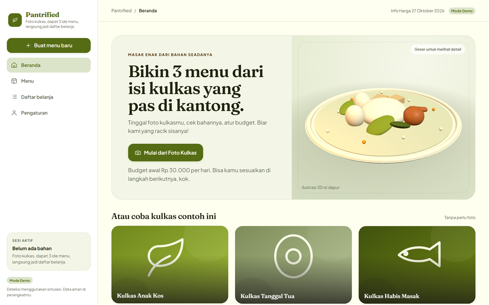
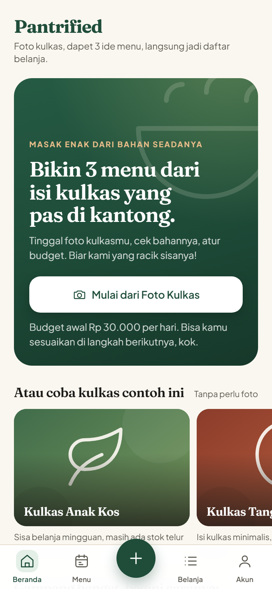
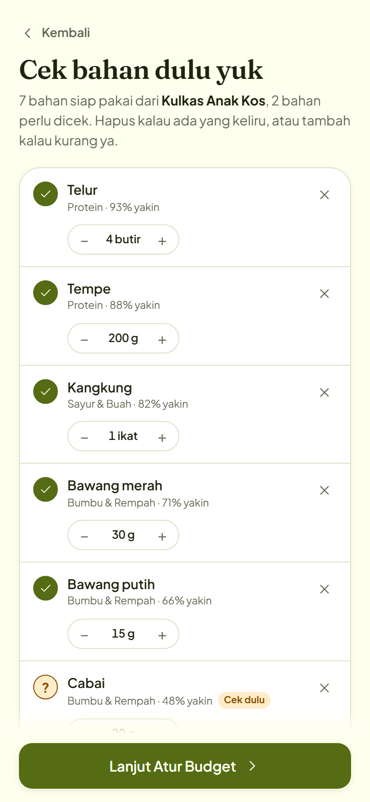
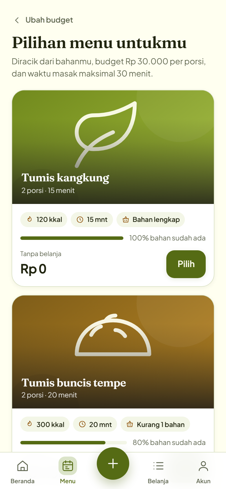
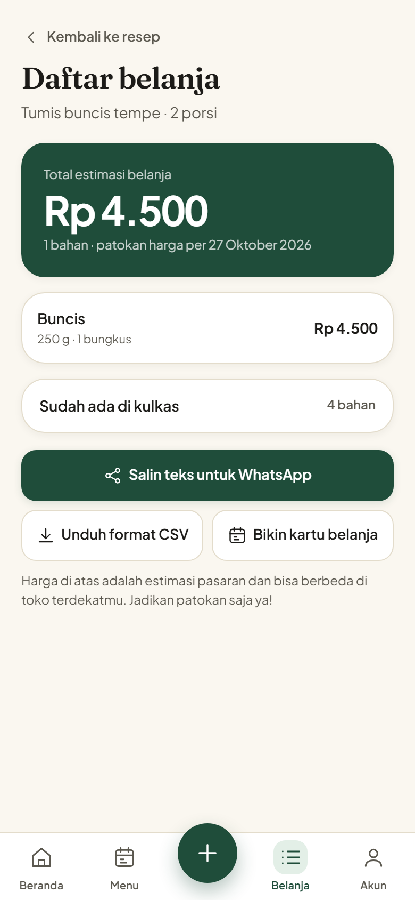
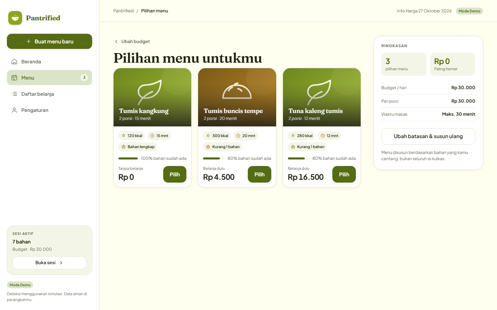
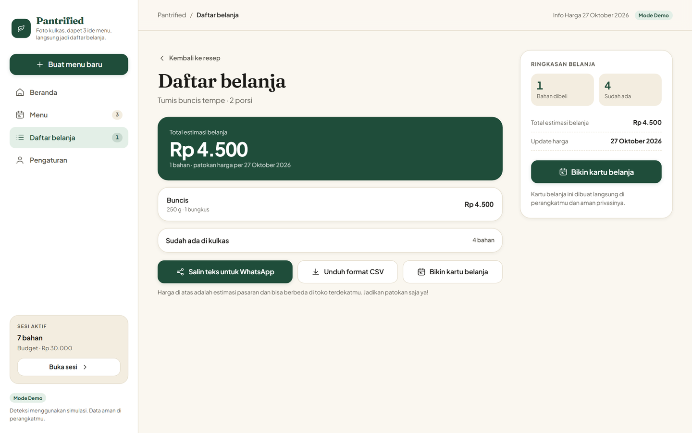

# Pantrified

**A fridge photo in, three budget-fit Indonesian meal plans out — plus a shopping list for only what is actually missing.**

Pantrified is a mobile-first PWA for students and young professionals who open the fridge, feel stuck, and end up ordering delivery. It reads the ingredients you already have, fits three meals to a daily budget in rupiah, and costs only the top-up shop.

[](https://nextjs.org)
[](https://react.dev)
[](https://www.typescriptlang.org)
[](https://web.dev/progressive-web-apps)
[](LICENSE)



## The problem

Deciding what to eat is a small decision made several times a day, and it is expensive in both time and money. Recipe apps assume an empty pantry and a Western supermarket. Delivery apps are fast but costly. Nothing starts from *what is already in the fridge*, *what the day's budget is*, and *what the smallest possible top-up shop looks like*.

Pantrified does exactly that, in Indonesian, with Jakarta price data.

## How it works

1. **Snap the fridge.** Take a photo or pick one, then review the detected ingredients. Quantities are editable, uncertain items are flagged for a human check, and anything wrong can be removed.
2. **Set the constraint.** Daily budget in IDR, meals per day, calories, diet, maximum cook time, and the equipment you actually own.
3. **Pick a plan.** Three ranked recipes with cost per portion, calories, cook time, pantry utilisation, and the missing-ingredient count.
4. **Shop the gap.** The grocery list contains only what is missing, rounded to real pack sizes, with a total and the price date. Copy it to WhatsApp, download CSV, or export a share card.

## Screens

| Mobile | | | |
| :---: | :---: | :---: | :---: |
| [](docs/screenshots/mobile-home.png) | [](docs/screenshots/mobile-review.png) | [](docs/screenshots/mobile-plans.png) | [](docs/screenshots/mobile-grocery.png) |
| Home | Review | Plans | Grocery |

| Desktop | |
| :---: | :---: |
| [](docs/screenshots/desktop-plans.png) | [](docs/screenshots/desktop-grocery.png) |
| Plans | Grocery |

## Highlights

- **Budget as a hard constraint.** The planner scores recipes on pantry fit, cost, calories, diet, cook time, and equipment, then shows the three best options. Pack rounding and missing-only costing keep the total honest.
- **Human in the loop.** The detector never silently decides. Low-confidence rows get an amber `?`, a "perlu dicek" tag, and a count in the header.
- **Local-first and offline-ready.** No account, no backend, no upload. State lives in `localStorage`; the service worker keeps the shell usable offline.
- **Designed for Indonesian kitchens.** Indonesian copy, rupiah formatting, local dishes and ingredients, and a warm kitchen-ledger visual language: cream paper, deep green, turmeric, Fraunces headings, Plus Jakarta Sans UI.
- **Two real layouts.** A 390px-first mobile flow with a tab bar and sticky CTAs, and a desktop shell from 1024px with a sidebar, rails, a three.js pantry still-life, and a two- or three-column plan grid.
- **Finishing touches that ship.** WhatsApp text export, CSV download, a 1080×1350 fabric.js share card, analytics consent gate, data export, and delete-everything.

## Knowledge base

The app ships with its own Indonesian food data, not a scraped recipe dump:

- **50 ingredient classes** with Indonesian names, search aliases (`tempeh`, `chayote`, `scallion`), categories, allergens, and kcal per 100 g.
- **50 recipes** across vegetables, eggs, tempe, tofu, chicken, fish, beef, rice, noodles, and breakfast, each with servings, cook time, equipment, diet tags, steps, and nutrition.
- **50 dated Jakarta price rows** with pack sizes, so the grocery list rounds to what a shop actually sells.
- **A validator** that runs before every production build: unique IDs and titles, valid units and equipment, real quantities, known ingredients, price math, dated prices, and ingredient coverage.

```bash
npm run validate:data
```

## Tech stack

| Layer | Choice |
| --- | --- |
| Framework | Next.js 16 App Router, static export (`output: "export"`) |
| UI | React 19, TypeScript 7, hand-written CSS with design tokens (no Tailwind) |
| Motion | CSS transitions on transform/opacity, `prefers-reduced-motion` guards |
| 3D hero | three.js, desktop only, lazy-loaded, pauses offscreen |
| Share card | fabric.js, drawn locally at 1080×1350 and exported as PNG |
| Persistence | `localStorage` (`pantrified.v1`), service worker, web app manifest |
| QA | Data validator before every build, 36 Playwright flow/offline/PWA checks, responsive audit at 320–1200px |

There are no runtime environment variables, API keys, or servers. Any static host works; installability needs HTTPS or `localhost`.

## Run it

```bash
git clone https://github.com/ffrizzyy/pantrified.git
cd pantrified/app
npm install
npm run dev
```

Open <http://localhost:3000> and use the device toolbar at a phone width. The desktop layout starts at 1024px.

Production build:

```bash
npm run build          # writes app/out/
npm run preview        # serves out/ at http://127.0.0.1:4173/
```

## Checks

```bash
cd app
npm run validate:data  # ingredients, prices, recipes: IDs, units, price math, coverage
npm run check          # 36 Playwright checks: PWA, offline, upload, alias search, plans, CSV, share card, desktop
npm run shots          # mobile screenshots of every screen, fails on console errors
node scripts/shot-desktop.mjs   # desktop flow incl. 3D hero and share card
npm run responsive     # 320/360/768/1024/1200 audit: overflow, labels, tap targets
```

All scripts accept `BASE_URL` (default `http://127.0.0.1:4173/`). Run them one at a time; the bundled Python preview server is single-threaded.

## Project layout

```
Pantrified/
  app/                  Next.js PWA (see app/README.md for the full map)
    app/                layout, page, global styles and design tokens
    components/         shell, screens, share card, icons, illustrations, three.js scene
    lib/                copy, types, recipe data, ingredient search, detector, planner, storage
    public/             manifest, service worker, icons
    scripts/            Playwright QA and screenshot scripts
  docs/screenshots/     README images
  PRD.md                product requirements, design system, architecture, roadmap
  PANTRIFIED_SPEC.md    build spec and phased plan
  RECIPE-DATA-PLAN.md   recipe and price data plan
  VISION-EVALUATION.md  design and product critique
```

## Status and limits

This is a working portfolio MVP, not a launched product.

- **Ingredient detection is simulated.** `lib/detect.ts` hashes the uploaded file and replays a seeded fridge scene. The image never leaves the device. The interface already consumes a `DetectionResult`, so a real model can replace it without touching the rest of the app.
- **The recipe set is 50 of the 150 planned**, and prices are a single sample table of 50 rows dated 2026-10-27, not a live feed.
- **No accounts, sync, or push notifications.** Data is per device and can be exported or deleted from Settings.
- **Mobile Safari and Chrome are the targets.** The 3D hero is decorative and desktop-only; the app is fully usable without it.

The roadmap in [PRD.md](PRD.md) covers the real detector (FastAPI + ONNX), a larger Indonesian recipe set, live price sourcing, and an English toggle.

## Documentation

- [PRD.md](PRD.md) — problem, users, scope, design system, architecture, data model, security, testing, deployment, costs, and risks.
- [PANTRIFIED_SPEC.md](PANTRIFIED_SPEC.md) — the phased build spec the app was implemented from.
- [RECIPE-DATA-PLAN.md](RECIPE-DATA-PLAN.md) — how recipe and price data is structured and expanded.
- [VISION-EVALUATION.md](VISION-EVALUATION.md) — an outside-in critique of the product and visual direction.
- [app/README.md](app/README.md) — developer notes, copy rules, and per-screen implementation details.

## License

[MIT](LICENSE) © 2026 ffrizzyy
